<picture>
  <source media="(prefers-color-scheme: dark)" srcset="./assets/header-dark.svg">
  
</picture>

  

  
  
  

 

<picture>
  <source media="(prefers-color-scheme: dark)" srcset="./assets/metrics-dark.svg">
  
</picture>

### ⚡ About me

I'm a **Data & Business Analyst** who has spent **9+ years** inside Brazilian agribusiness, working where commercial data turns into money.

- 📈 At **Agro Amazônia** I run the analytics for **70+ supplier rebate and sales-incentive campaigns a year**: calculation, forecasting, supplier validation and accounting reconciliation. The work hits the P&L directly, and my reports go to the commercial VP and the CEO.
- 🌾 Before that I spent **7 years at Louis Dreyfus Company** building performance and Capex analytics for soy and corn warehouses across Brazil.
- 🛠️ As founder of **Yamazing**, I build production SaaS with React, TypeScript, Supabase and LLM APIs, shipped through AI-assisted engineering (Claude Code, Lovable, Replit).
- 🎓 **Microsoft Certified: Power BI Data Analyst Associate**, and studying **Data Science** at Mackenzie.

### 🧰 Toolbox

<picture>
  <source media="(prefers-color-scheme: dark)" srcset="./assets/stack-dark.svg">
  
</picture>

### 🚀 Featured work

  <a href="https://github.com/jleonardopl1/agrodecision-d2525243"><picture><source media="(prefers-color-scheme: dark)" srcset="./assets/project-agrodecision-dark.svg"></picture></a>
  <a href="https://github.com/jleonardopl1/levelup-exams"><picture><source media="(prefers-color-scheme: dark)" srcset="./assets/project-levelup-dark.svg"></picture></a>
  <a href="https://github.com/jleonardopl1/English-Fluency"><picture><source media="(prefers-color-scheme: dark)" srcset="./assets/project-english-dark.svg"></picture></a>
  <a href="https://github.com/jleonardopl1/jleonardopl.github.io"><picture><source media="(prefers-color-scheme: dark)" srcset="./assets/project-greenrev-dark.svg"></picture></a>

### 🧭 Journey

<picture>
  <source media="(prefers-color-scheme: dark)" srcset="./assets/timeline-dark.svg">
  
</picture>

### 🐍 Contribution activity

<picture>
  <source media="(prefers-color-scheme: dark)" srcset="https://raw.githubusercontent.com/jleonardopl1/jleonardopl1/output/snake-dark.svg">
  
</picture>

<b>🇧🇷 Resumo em português</b>

 

Analista de Dados e Negócios com 9+ anos no agronegócio. Hoje cuido da análise de 70+ campanhas de rebate e premiação por ano na Agro Amazônia; antes, passei 7 anos com analytics operacional e de Capex na Louis Dreyfus Company. Certificado Microsoft Power BI Data Analyst Associate, estudante de Ciência de Dados no Mackenzie e fundador da Yamazing, onde construo SaaS com React, TypeScript, Supabase e IA.

 

<picture>
  <source media="(prefers-color-scheme: dark)" srcset="./assets/footer-dark.svg">
  
</picture>
